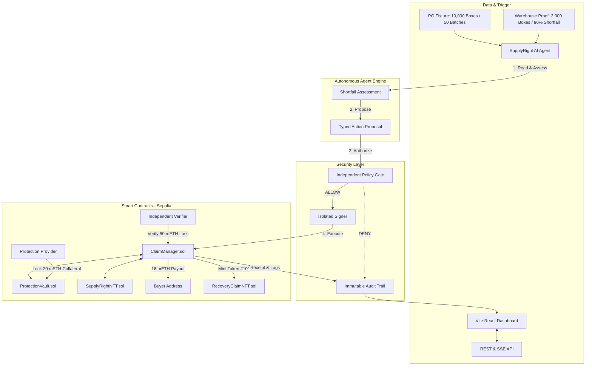

# SupplyRight AI

> **Autonomous On-Chain Protection & Policy-Gated Settlement Engine for SMEs**  
> **Competition**: Fintechathon 2026 / International Track / **Topic F: Autonomous On-Chain Wallet**  
> **Network**: Ethereum Sepolia (`Chain ID: 11155111`)  
> **Status**: Verified via 30 Automated Tests (14 Foundry + 16 Backend & Policy Tests) · Production Build Ready

---

## 🌟 Executive Overview

**SupplyRight AI** provides small and medium-sized enterprises (SMEs) with an autonomous, policy-gated trade protection and settlement infrastructure on Ethereum Sepolia. By combining **Three-Way Matching** (Purchase Order + Carrier Dispatch Manifest + Warehouse Receiving Tally) with an **Invisible Web3 (Dual-View)** enterprise UI, the platform eliminates months of dispute friction without exposing procurement teams to raw crypto complexity:

1. **Reads & Triangulates Multi-Source Evidence**: Cross-references purchase orders, carrier bills of lading (BOL), and accredited SGS warehouse receipts, mathematically eliminating moral hazard and buyer-inspector collusion.
2. **Defends Against Adversarial Inputs**: A Cognitive Prompt Injection Firewall sanitizes malicious commands embedded inside untrusted invoice notes before they reach the agent.
3. **Formulates Bounded Actions**: Proposes typed, parameter-validated settlement proposals with zero speculative hallucination.
4. **Passes 7 Independent Policy Hard Gates**: Strictly evaluates chain ID (`11155111`), contract allowlist, function selectors, role authority, nonce anti-replay, verifier attestation, and collateral adequacy.
5. **Executes via Isolated Signer**: Private keys reside strictly inside an isolated custody boundary outside the LLM context.
6. **Settles Atomically & Subrogates**: Dispatches compensation payouts to the buyer while atomically minting a **Recovery Claim NFT** representing enforceable subrogation rights (countersigned under UNCITRAL MLETR) against the defaulting supplier.

---

## 🏗️ System Architecture



---

## 📦 Monorepo Structure

```
supply-right-ai/
├── contracts/               # Solidity Smart Contracts (Foundry)
│   ├── src/
│   │   ├── MockETH.sol          # Valueless mock ERC-20 token (mETH)
│   │   ├── SupplyRightNFT.sol   # ERC-721 PO commitment token
│   │   ├── ProtectionVault.sol  # Provider collateral vault
│   │   ├── ClaimManager.sol     # Settlement orchestrator
│   │   └── RecoveryClaimNFT.sol # ERC-721 recovery claim right
│   ├── test/SupplyRight.t.sol   # 14 comprehensive tests (TC-01 through TC-10)
│   ├── script/Deploy.s.sol      # Foundry deployment script
│   └── deployments/sepolia.json # Sepolia addresses & registry
├── backend/                 # AI Agent & Policy Engine Service (TypeScript/Node.js)
│   ├── src/
│   │   ├── agent/               # 6-stage decision sequence (Read, Assess, Propose...)
│   │   ├── policy/              # Independent multi-rule policy allowlist engine
│   │   ├── signer/              # Isolated signer running outside LLM context
│   │   ├── blockchain/          # StateManager, typed ABIs, Sepolia bindings
│   │   └── api/                 # Express REST endpoints & real-time SSE stream
│   └── test/agent-policy.test.ts# 8 automated unit & integration tests
├── frontend/                # Interactive Demonstration Dashboard (React / Vite / TypeScript)
│   ├── src/
│   │   ├── components/          # Header, ScenarioBar, PipelineView, PolicyGate...
│   │   ├── index.css            # Token-based CSS design system (no-slop R2 Composed)
│   │   └── App.tsx              # Live dashboard & real-time SSE synchronization
├── fixtures/
│   └── seed.json            # Deterministic demo fixture (50 ordered, 10 delivered, 80 mETH loss)
├── docs/
│   ├── architecture.md          # Technical architecture & authority matrix
│   ├── security-assessment.md   # Zero-trust threat model & policy gate specifications
│   └── execution-evidence.md    # Test outputs & execution evidence
├── memory.md                # Project memory & context document
├── PLAN.md                  # Implementation roadmap & milestones
└── DESIGN.md                # Design system specification
```

---

## ⚡ Quick Start & Reproduction

### Prerequisites
- **Node.js** v20+ or v24+
- **Foundry** (`forge` and `anvil`) installed (`curl -L https://foundry.paradigm.xyz | bash && foundryup`)

### 1. Run Automated Test Suites
```bash
# Clone repository
git clone <repo-url>
cd supply-right-ai

# Run all 22 tests (14 Foundry tests + 8 Backend tests)
npm run test:all
```

### 2. Build Monorepo
```bash
npm run build
```

### 3. Launch Interactive Demo (Instant 1-Click)
Run the automated startup script which automatically kills conflicting ports, starts services, and launches your browser:
```bash
./start.sh
# or:
npm start
```

Alternatively, run in separate terminals manually:
```bash
# Terminal 1: Backend service (http://localhost:3001)
npm run dev:backend

# Terminal 2: Frontend dashboard (http://localhost:5173)
npm run dev:frontend
```
Open **http://localhost:5173** in your browser.

---

## 🛡️ Security & Zero-Trust Verification

1. **Private Key Isolation**: Private keys are strictly managed inside `IsolatedSigner` and are **never** passed into LLM context, prompt templates, or user-facing logs.
2. **Independent Policy Gate**: Every proposed transaction is evaluated against 7 explicit allowlists:
   - `CHAIN_ID_ALLOWLIST`: Restricts execution to Ethereum Sepolia (`11155111`).
   - `CONTRACT_ALLOWLIST`: Restricts calls to authorized contract addresses.
   - `FUNCTION_ALLOWLIST`: Restricts calls to approved ABI signatures.
   - `ROLE_AUTHORITY`: Enforces cryptographic separation of roles.
   - `NONCE_IDEMPOTENCY`: Rejects duplicate or replayed nonces.
   - `VERIFIER_APPROVAL_REQUIRED`: Guarantees no settlement without independent verifier attestation.
   - `VALUE_CAP_ENFORCEMENT`: Caps payout to $\min(\text{coveredAmount}, \text{collateral}, 20\text{ mETH})$.
3. **Atomic Execution**: Payout release and Recovery NFT mint occur in a single transaction; any failure causes a complete state revert.

---

## 👥 Team
- **Rivaldi & Jessica**: Source code, smart contracts, agent integration, execution evidence.
- **Athallah**: Security self-assessment, technical documentation.
- **Fariz**: Demo video & visual narrative.
- **Mel**: Presentation deck & strategic positioning.
